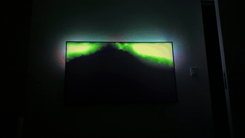
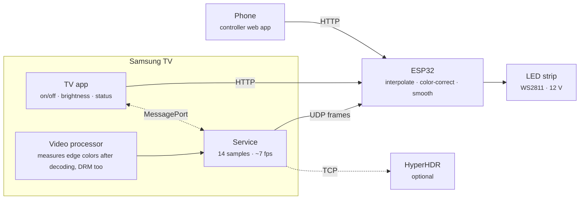
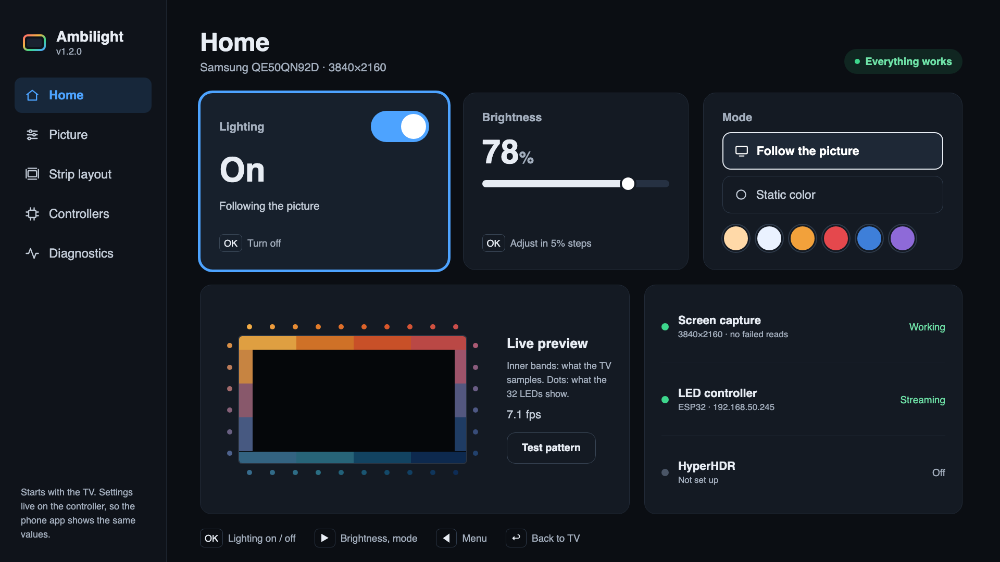
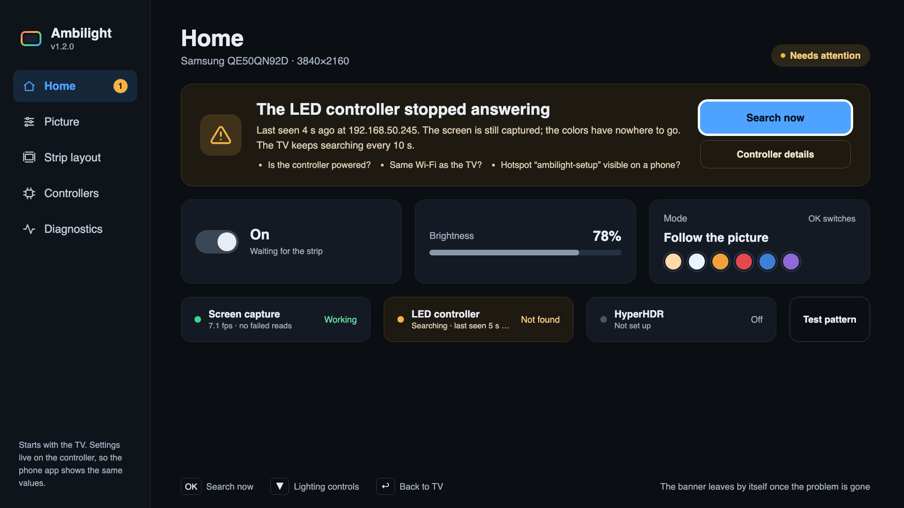
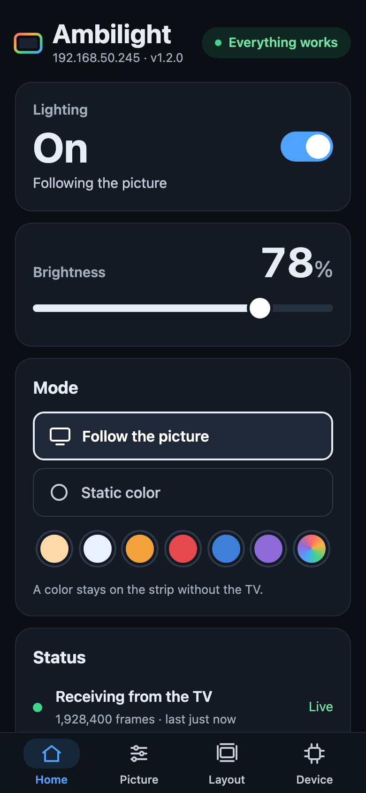
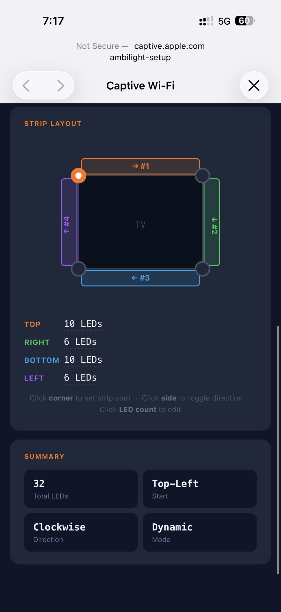
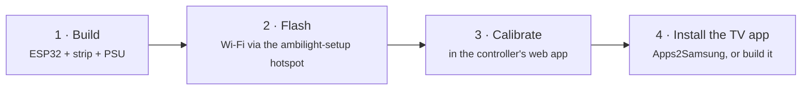

# Tizen OS Ambilight

**Ambilight for Samsung TVs, straight from the video processor.** No HDMI splitter, no camera.

  

## How it works

The TV finds its controllers on its own. [Architecture](docs/ARCHITECTURE.md) · [Protocol](protocol/README.md) · [How the capture API was found](docs/RESEARCH.md)

## Screens

  
  

  
  

## Supported TVs

| Model | Year | Status |
|---|---|---|
| QN90D · QN92D · Q60D | 2024 | ✅ |
| Q6F | — | ❌ [#2](https://github.com/exzos28/tizen-os-ambilight/issues/2) |

[Install the app](#install-the-tv-app) — its home screen tells you whether your TV works. [Report it](docs/CONTRIBUTING.md) either way.

## Get started

[Hardware](docs/HARDWARE.md) · [Installation](docs/INSTALL.md) · [Latest release](https://github.com/exzos28/tizen-os-ambilight/releases/latest)

## Install the TV app

The quickest way is [Apps2Samsung](https://github.com/Apps2Samsung/Apps2Samsung): no Tizen Studio, no build.

1. Turn on Developer Mode on the TV: open **Apps**, press **1 2 3 4 5** on the remote, switch *Developer mode* on and enter the IP of the computer or phone running Apps2Samsung as *Host PC IP*. Restart the TV: hold the power button for ~5 s.
2. Open Apps2Samsung on that computer or phone (same network as the TV) and pick the TV.
3. Find **Tizen OS Ambilight** in the catalog and press *Install*. The first install asks you to sign in to Samsung once to create a certificate for your TV.
4. Open **Ambilight** on the TV and press **Start** in the banner. From then on the service starts by itself when the TV boots.

Installed it from VS Code before? Delete it on the TV first: a package signed with another certificate can't be installed over it. A release `.wgt`, TV-Store, building from source: [Installation § TV apps](docs/INSTALL.md#4-tv-apps).

## More

[Networking](docs/NETWORKING.md) · [HyperHDR](docs/HYPERHDR.md) · [TV apps](tv/README.md) · [UI kit](packages/ui/README.md) · [Tools](tools/README.md) · [Contributing](docs/CONTRIBUTING.md) · MIT [License](LICENSE)

Created for educational purposes through reverse engineering. No responsibility is assumed for any use of this code, including violations of third-party terms of service or damage to equipment. Use at your own risk.
