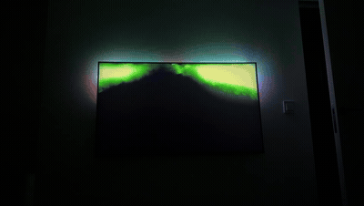

# Tizen OS Ambilight

> **Disclaimer:** This project was created solely for **educational purposes** through reverse engineering. The author assumes **no responsibility** for any use of this code, including but not limited to violation of third-party software terms of service, damage to equipment, or any other consequences. Use at your own risk.

DIY ambilight for Samsung Tizen TVs — captures edge colors directly from the TV's video processor, no HDMI splitter or external camera needed.



## How it works

Samsung TVs have a hardware block in the video processor that measures the average color of small screen regions. Samsung exposes it to Philips Hue Sync through a partner API; this project calls the same native library (`libvideoenhance.so`) directly. Because the measurement happens in the video pipeline after decoding, it works with built-in streaming apps, including DRM-protected content.

```
Samsung TV                              ESP32                     LED strip
┌───────────────────────────┐  UDP     ┌──────────────────────┐   ┌──────────┐
│ Tizen service (.NET)      │ ───────► │ interpolate, color   │ ─►│ WS2811   │
│ samples 14 edge points    │  :9001   │ correct, smooth      │   │ 12 V     │
└───────────────────────────┘          └──────────────────────┘   └──────────┘
```

The TV finds the ESP32 automatically via UDP broadcast — no IP configuration needed. Details: [Architecture](docs/ARCHITECTURE.md), [the reverse-engineering story](docs/RESEARCH.md).

## Features

- No extra hardware on the video path: no HDMI splitter, no camera
- Works with DRM-protected content in built-in apps
- Web UI on the ESP32: LED layout calibration, brightness, gamma, saturation, white balance, optional power limit
- Wi-Fi setup through a captive portal, OTA firmware updates, Telnet log
- Plain color mode when ambilight is off
- One TV can drive several ESP32 controllers at once (give each a different IP — see [Installation](docs/INSTALL.md#2-connect-to-wi-fi))
- Optional output to a [HyperHDR](docs/HYPERHDR.md) server, to drive WLED, Hyperk, Hue and other devices HyperHDR supports — **untested on a TV yet**

## Supported TVs

| TV Model | Tizen Version | Status |
|----------|--------------|--------|
| Samsung QN90D | Tizen 9.0 (SDP) | ✅ Confirmed working |
| Samsung Q60D | Tizen 9.0 (SDP) | ✅ Confirmed working |
| Samsung Q6F | — | ❌ HW color measurement returns an error ([#2](https://github.com/exzos28/tizen-os-ambilight/issues/2)) |

Support depends on the TV's video processor, not only on the Tizen version. Tried it on another model? Please report the result — see [Contributing](docs/CONTRIBUTING.md).

## Limitations

- **Frame rate.** The hardware measures 2 regions per 20 ms, so 14 sample points take ~140 ms (~7 updates/s). The ESP32 blends between frames, so changes look smooth rather than steppy, but fast flashes are not tracked.
- **Resolution.** 4 points per horizontal edge and 3 per vertical edge are sampled; the ESP32 interpolates them to the actual LED count.
- **Installation.** The TV app needs Developer Mode and a Samsung certificate tied to your TV — see [Installation](docs/INSTALL.md).

## Quick start

1. **Build the hardware** — ESP32, 12 V WS2811 strip, 12 V PSU, DC-DC converter. → [Hardware](docs/HARDWARE.md)
2. **Flash the ESP32** — prebuilt image from [Releases](https://github.com/exzos28/tizen-os-ambilight/releases) or build it — and connect it to Wi-Fi through the `ambilight-setup` access point. → [Installation § ESP32](docs/INSTALL.md#1-esp32-firmware)
3. **Calibrate the strip** in the web UI: LEDs per side, start corner, direction. → [Installation § Calibration](docs/INSTALL.md#3-calibrate-the-strip)
4. **Install the TV apps** (service + launcher UI) and open *Ambilight*: Home shows whether everything works. → [Installation § TV](docs/INSTALL.md#4-tv-apps)

## Documentation

| Guide | Description |
|-------|-------------|
| [Installation](docs/INSTALL.md) | Flashing, Wi-Fi setup, calibration, TV app install, troubleshooting |
| [Hardware](docs/HARDWARE.md) | Wiring schematic, component list, photos |
| [Architecture](docs/ARCHITECTURE.md) | Components, data flow, configuration reference |
| [Networking](docs/NETWORKING.md) | Ports, UDP frame format, discovery, ESP32 HTTP API |
| [HyperHDR](docs/HYPERHDR.md) | Streaming to a HyperHDR server instead of / besides the ESP32 (untested on a TV) |
| [Research](docs/RESEARCH.md) | How the capture API was found, rejected approaches |
| [TV service](tv/README.md) | Capture loop and tuning on the TV side |
| [Tools](tools/README.md) | Desktop frame viewer and LED test pattern generator |
| [Contributing](docs/CONTRIBUTING.md) | Reporting TV compatibility, pull requests |

## License

MIT License. See [LICENSE](LICENSE).
