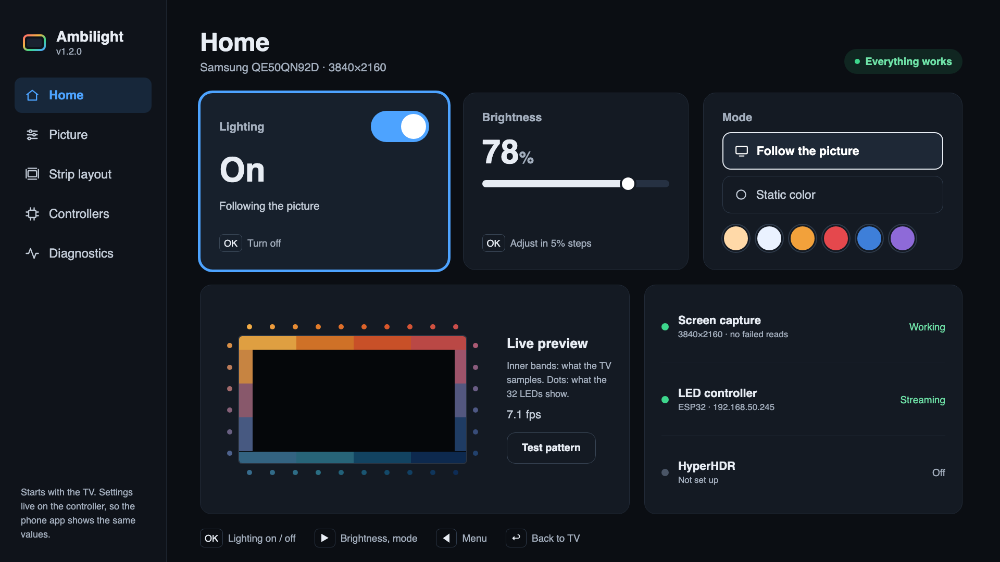
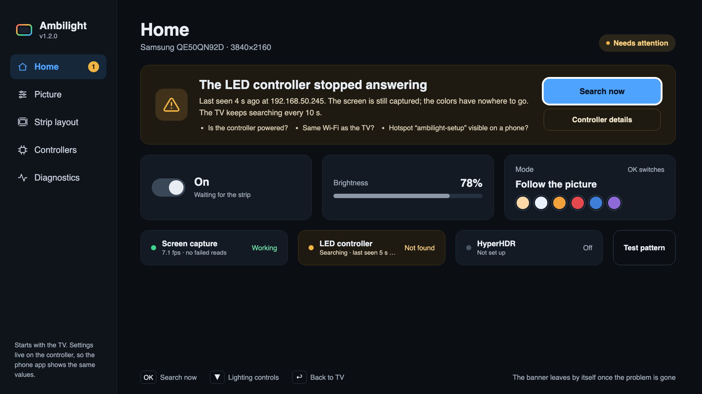

# Tizen OS Ambilight

**Ambilight for Samsung TVs, straight from the video processor.** No HDMI splitter, no camera — the TV measures its own picture and an ESP32 lights the wall behind it.

[](https://github.com/exzos28/tizen-os-ambilight/releases/latest) [](https://github.com/exzos28/tizen-os-ambilight/actions/workflows/build.yml) [](LICENSE)


## Highlights

- **Inside the video pipeline.** Colors are measured after decoding, so built-in streaming apps work too, DRM included.
- **Zero network setup.** The TV finds its controllers by itself.
- **One press on the remote.** Lighting on or off, brightness and mode right on the home screen of the TV app — and it tells you at once whether your TV is supported.
- **Tuned from your phone.** The controller's web app handles calibration, color correction, a power limit, Wi-Fi setup and firmware updates.
- **Plays with others.** Optional [HyperHDR](docs/HYPERHDR.md) output for WLED, Hue and friends (untested on a TV yet).

## On the TV

<p>
  
  
</p>

The most frequent actions come first: the remote's focus starts on the lighting switch. When something breaks, the problem and its fix take the top of the screen instead.

## On the phone

<p>
  
  &nbsp;
  
</p>

The ESP32 serves its own web app — also the way in for first-time Wi-Fi setup, through the `ambilight-setup` hotspot.

## How it works

```
Samsung TV                                    ESP32                     LED strip
┌─────────────────────────────────┐  UDP     ┌──────────────────────┐   ┌──────────┐
│ service (.NET): 14 edge samples │ ───────► │ interpolate, color   │ ─►│ WS2811   │
│ launcher: controls and status   │  :9001   │ correct, smooth      │   │ 12 V     │
└─────────────────────────────────┘          └──────────────────────┘   └──────────┘
```

Samsung TVs have a hardware block in the video processor that measures the average color of small screen regions — the one Philips Hue Sync uses through a partner API. This project calls the same native library (`libvideoenhance.so`) directly. The full story: [Research](docs/RESEARCH.md).

## Supported TVs

| TV model | Year | Tizen | Status |
|----------|------|-------|--------|
| Samsung QN90D | 2024 | 9.0 (SDP) | ✅ Works |
| Samsung QN92D | 2024 | — | ✅ Works |
| Samsung Q60D | 2024 | 9.0 (SDP) | ✅ Works |
| Samsung Q6F | — | — | ❌ Color measurement returns an error ([#2](https://github.com/exzos28/tizen-os-ambilight/issues/2)) |

It depends on the TV's video processor, not only on the Tizen version. Install the TV app and its home screen tells you whether yours works — then [report it](docs/CONTRIBUTING.md), either way.

## Get started

1. **Build** — ESP32, 12 V WS2811 strip, power supply. → [Hardware](docs/HARDWARE.md)
2. **Flash** the [latest firmware](https://github.com/exzos28/tizen-os-ambilight/releases/latest) and join Wi-Fi through the `ambilight-setup` hotspot. → [Install § ESP32](docs/INSTALL.md#1-esp32-firmware)
3. **Calibrate** the strip in the controller's web app. → [Install § Calibration](docs/INSTALL.md#3-calibrate-the-strip)
4. **Install the TV app** from the release with [Apps2Samsung](docs/INSTALL.md#40-install-with-apps2samsung), or build it yourself. → [Install § TV](docs/INSTALL.md#4-tv-apps)

## Good to know

- **~7 updates per second.** The hardware measures 2 regions per 20 ms; the ESP32 blends between frames, so motion looks smooth, but fast flashes are missed.
- **14 sample points** (4 per horizontal edge, 3 per vertical), interpolated to however many LEDs you have.
- **Developer Mode** and a certificate tied to your TV are needed — Apps2Samsung takes care of the certificate.

## Documentation

| | |
|---|---|
| [Installation](docs/INSTALL.md) | Flashing, Wi-Fi, calibration, TV app, troubleshooting |
| [Hardware](docs/HARDWARE.md) | Wiring, parts, photos |
| [Architecture](docs/ARCHITECTURE.md) | Components, data flow, settings |
| [Networking](docs/NETWORKING.md) | Ports, frame format, discovery, HTTP API |
| [Protocol](protocol/README.md) | Machine-readable schemas shared by the firmware, the TV and the web apps |
| [HyperHDR](docs/HYPERHDR.md) | Streaming to a HyperHDR server (untested on a TV) |
| [Research](docs/RESEARCH.md) | How the capture API was found |
| [TV apps](tv/README.md) · [Tools](tools/README.md) | The TV side in detail · desktop frame viewer and LED tester |
| [Contributing](docs/CONTRIBUTING.md) | TV compatibility reports, pull requests |

## License

MIT — see [LICENSE](LICENSE).

> Created for **educational purposes** through reverse engineering. The author assumes **no responsibility** for any use of this code, including violations of third-party terms of service or damage to equipment. Use at your own risk.
