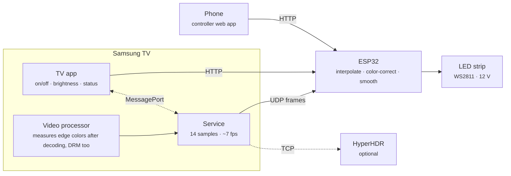
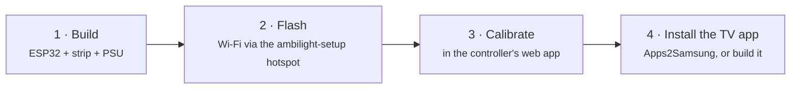

# Tizen OS Ambilight

**Ambilight for Samsung TVs, straight from the video processor.** No HDMI splitter, no camera.

  

## How it works

The TV finds its controllers on its own. [Architecture](docs/ARCHITECTURE.md) · [Protocol](protocol/README.md) · [How the capture API was found](docs/RESEARCH.md)

## Screens

  
  

  
  

## Supported TVs

| Model | Year | Status |
|---|---|---|
| QN90D · QN92D · Q60D | 2024 | ✅ |
| Q6F | — | ❌ [#2](https://github.com/exzos28/tizen-os-ambilight/issues/2) |

Install the app — its home screen tells you whether your TV works. [Report it](docs/CONTRIBUTING.md) either way.

## Get started

[Hardware](docs/HARDWARE.md) · [Installation](docs/INSTALL.md) · [Latest release](https://github.com/exzos28/tizen-os-ambilight/releases/latest)

## More

[Networking](docs/NETWORKING.md) · [HyperHDR](docs/HYPERHDR.md) · [TV apps](tv/README.md) · [Tools](tools/README.md) · [Contributing](docs/CONTRIBUTING.md) · MIT [License](LICENSE)

Created for educational purposes through reverse engineering. No responsibility is assumed for any use of this code, including violations of third-party terms of service or damage to equipment. Use at your own risk.
