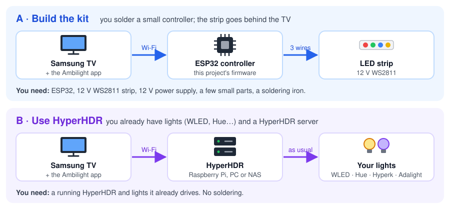
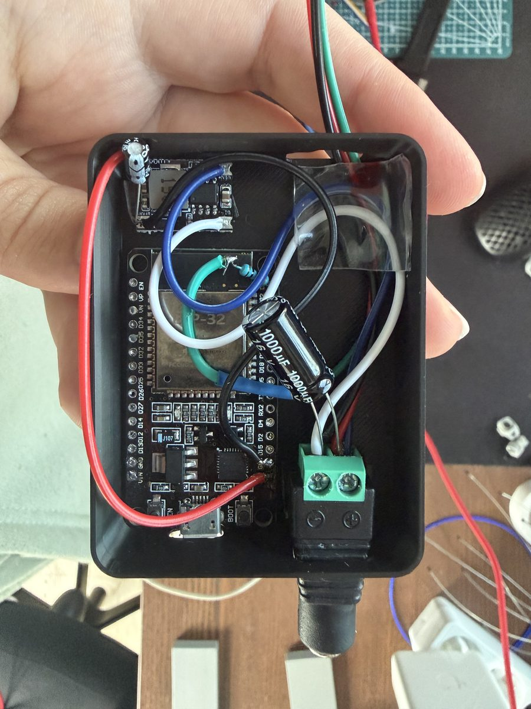
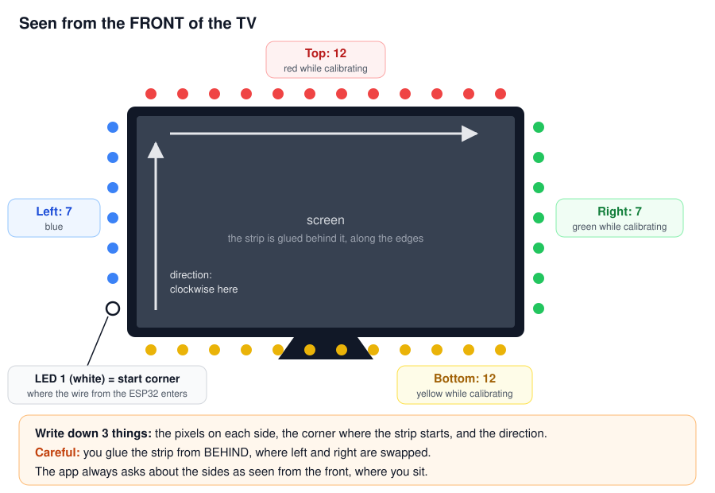
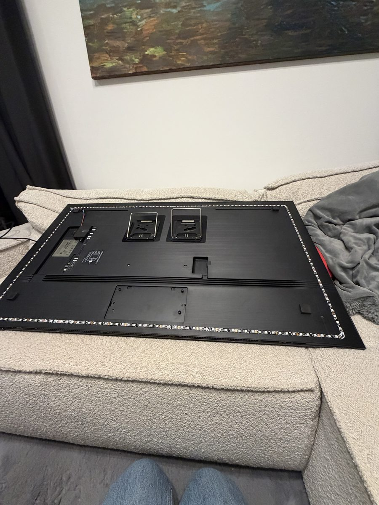

# Build your own Ambilight

**A** if you have nothing yet. **B** if you already run [HyperHDR](https://github.com/awawa-dev/HyperHDR) with WLED, Hue or other lights. Both at once works too.

## 1. Check your TV first

Before buying anything:

1. On the TV: **Apps** → press **1 2 3 4 5** → *Developer mode* on, *Host PC IP* = your computer or phone. Restart the TV (hold power ~5 s).
2. In [Apps2Samsung](https://github.com/Apps2Samsung/Apps2Samsung): pick the TV → **Tizen OS Ambilight** → *Install*.
3. Open **Ambilight** on the TV → **Start**.

**Screen capture · Working** at the top → go on. A banner saying the TV doesn't expose the capture API → this TV can't do it. Either way, [report your TV](CONTRIBUTING.md).

---

## Path A: build the kit

### A1. Parts

| Part | Buy |
|---|---|
| Controller | Classic **ESP32** dev board (ESP32-WROOM-32 / DevKitC) |
| Strip | **12 V WS2811**, the perimeter of the TV (55" ≈ 3.8 m) |
| Power supply | **12 V**, slim, W/m × meters + 20 % (≈ 100 W for 55") |
| Converter | DC-DC **12 V → 5 V**, 1 A+ |
| Small parts | Capacitors 1000 µF 16 V and 100 µF 10 V, resistor 330 Ω, barrel jack 5.5 × 2.1, JST-SM 3-pin pair |

Tools: soldering iron, multimeter.

### A2. The strip

### A3. Solder the controller

1. Capacitor 1000 µF across the barrel jack (stripe = −).
2. Jack → strip plug (+12 V, GND) and → converter input.
3. **Measure the converter output: 5.0 V**, before connecting the ESP32.
4. Converter → ESP32 **5V/VIN** and **GND**, 100 µF across it.
5. ESP32 **GPIO 23** → 330 Ω → strip data.

Details: [HARDWARE.md](HARDWARE.md).

### A4. Stick the strip on

### A5. Flash

1. Download `ambilight-esp32-factory.bin` from the [latest release](https://github.com/exzos28/tizen-os-ambilight/releases/latest).
2. In Chrome or Edge open the [ESP Web Flasher](https://espressif.github.io/esptool-js/), connect the ESP32 over USB.
3. *Connect* → file at **0x0** → *Program*.

No port? Install the *CP210x* or *CH340* USB driver. Won't connect? Hold **BOOT** while connecting.

### A6. Wi-Fi

1. Power on → join the **`ambilight-setup`** Wi-Fi on your phone.
2. Pick your home Wi-Fi (**2.4 GHz**) → *Connect*.
3. Back on home Wi-Fi, open **`http://ambilight.local`** (or the address ending in **.245**).

### A7. Calibrate

**Layout** tab: pixels per side, start corner, direction. The strip lights **top red, right green, bottom yellow, left blue**, first pixel white. All four right → **Save layout**.

### A8. Done

On the TV: Ambilight → **LED strip with an ESP32**. The TV finds the controller itself.

---

## Path B: HyperHDR

In HyperHDR (v20+):
- *Flatbuffers server*: on, port **19400**.
- *Black border detection*: **off**.
- *Smoothing*: ~250 ms.

On the TV: Ambilight → **HyperHDR server** (or *Outputs* → *HyperHDR*) → its IP and port 19400 → **Apply and test**. HyperHDR gets a new source, **Tizen Ambilight**.

More: [HYPERHDR.md](HYPERHDR.md).

---

## Problems

| Symptom | Check |
|---|---|
| Service doesn't start | Update the app: Tizen 5.5–7 needs 1.2.2+ |
| No `ambilight-setup` | 5 V on the ESP32? Flash again |
| TV doesn't find the controller | Same network, not a guest one |
| Wrong side colors while calibrating | Start corner or direction. From the front! |
| Red shows as green etc. | [Color order](HARDWARE.md#led-color-order) |
| First pixels flicker | Short data wire, 330 Ω, common GND |
| Far end dim on white | Power both ends of the strip |

Stuck? [Open an issue](https://github.com/exzos28/tizen-os-ambilight/issues/new/choose) with the TV model and a photo of *Diagnostics*.
