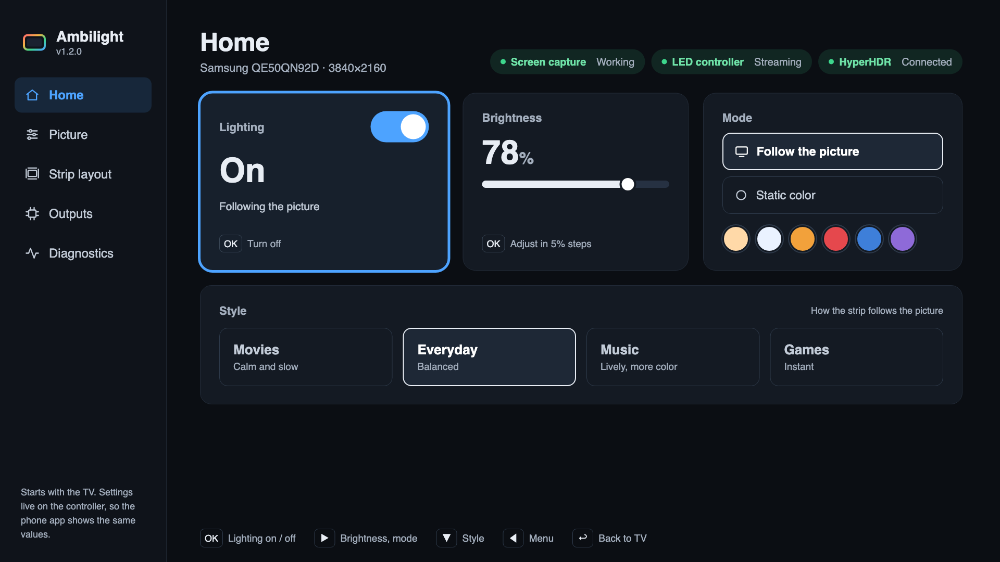
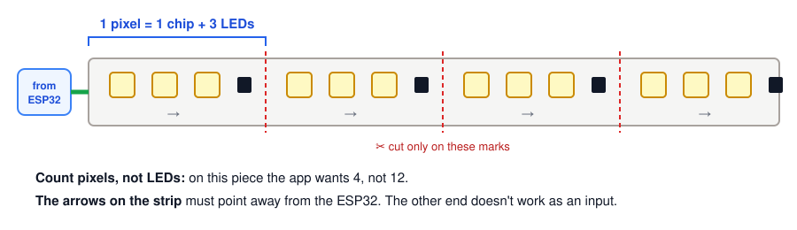
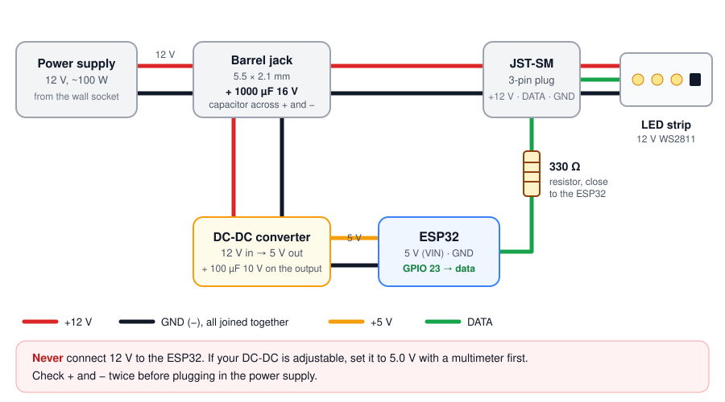
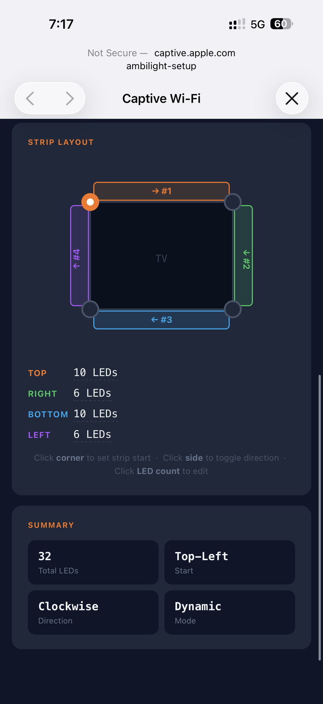
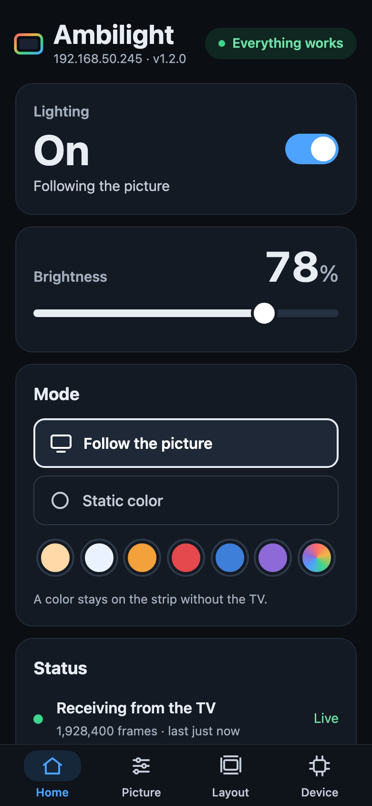

# Build your own Ambilight

A step-by-step guide for people who have never done this before. It takes an evening: about an hour of soldering, half an hour of sticking the strip on, and a few minutes of setup.

## Pick your way

| | **A · Build the kit** | **B · Use HyperHDR** |
|---|---|---|
| For whom | You have nothing yet and want a strip behind the TV | You already run [HyperHDR](https://github.com/awawa-dev/HyperHDR) with WLED, Hue or other lights |
| Soldering | Yes, a few wires | No |
| Extra box running all the time | No, only the small controller behind the TV | Yes, the HyperHDR machine (Raspberry Pi, PC, NAS) |
| Go to | [Step 1](#step-1-check-your-tv-first), then [Path A](#path-a-build-the-kit) | [Step 1](#step-1-check-your-tv-first), then [Path B](#path-b-hyperhdr) |

You can also run both at once: the strip behind the TV and your HyperHDR lights.

## Step 1. Check your TV first

**Do this before you buy anything.** Not every Samsung TV can do it: the TV has to measure the picture in hardware, a feature Samsung added for Philips Hue Sync. The Ambilight app checks this for you.

1. **Turn on Developer Mode** on the TV: open **Apps**, press **1 2 3 4 5** on the remote, switch *Developer mode* on and enter the IP address of your computer or phone as *Host PC IP*. Restart the TV: hold the power button for about 5 seconds.
2. **Install the app.** Open [Apps2Samsung](https://github.com/Apps2Samsung/Apps2Samsung) on that computer or phone (same Wi-Fi as the TV), pick the TV, find **Tizen OS Ambilight** in the catalog and press *Install*. The first time it asks you to sign in to Samsung once.
3. **Open Ambilight** on the TV and press **Start** in the banner.

If the home screen says **This TV is supported** and the preview shows the colors of the picture, you're good. If it says the TV doesn't expose the capture API, the TV can't do it, and buying parts won't help. Either way, please [report your TV](CONTRIBUTING.md): the list of [supported TVs](../README.md#supported-tvs) grows from these reports.

On the first start the app asks **What lights do you have?** You can pick now or press *Skip for now* and come back from *Outputs* later.

---

## Path A: build the kit

### A1. Buy the parts

| Part | What to look for | Why |
|---|---|---|
| **ESP32 board** | A classic ESP32 dev board: *ESP32-WROOM-32*, *ESP32 DevKitC* or similar, with a USB port | The controller. The ready-made firmware is for this chip; S2, S3 and C3 boards need their own build |
| **LED strip** | **12 V WS2811**, enough to go around the TV (see below) | 12 V loses less brightness along the strip than 5 V |
| **Power supply** | **12 V**, about 100 W, a slim one (1.8 cm) fits behind the TV | Powers the strip and, through the converter, the ESP32 |
| **DC-DC converter** | 12 V → 5 V step-down, 1 A or more | The ESP32 needs 5 V, never 12 V |
| **Capacitors** | 1000 µF 16 V, and 100 µF 10 V | Smooth the power when the strip suddenly changes brightness |
| **Resistor** | 330 Ω, 1/4 W | Goes in the data wire; keeps the signal clean |
| **Connectors** | DC barrel jack 5.5 × 2.1 mm, JST-SM 3-pin pair, corner connectors for the strip | So you can unplug everything and go around corners without soldering |
| **Small stuff** | Wire, heat shrink, a small box for the controller, a fuse holder (optional) | |

**Tools:** a soldering iron, a multimeter (to check 5 V and polarity), wire strippers.

**How much strip?** Measure the four edges of the TV's back panel and add them up. A 55" TV is roughly 1.2 × 0.7 m, so about 3.8 m. **How big a power supply?** Take the watts per meter from the strip's listing, multiply by the length and add 20 %. For example, 14.4 W/m × 3.8 m ≈ 55 W, so a 100 W supply is plenty.

### A2. Understand the strip

- On a 12 V WS2811 strip, LEDs come in groups (usually 3) driven by one chip. A group is one **pixel**, and it's what the app counts.
- Cut only on the marked lines between pixels.
- The strip has **arrows**. Data goes in only from the side the arrows point away from. Start the strip at the end where you'll connect the ESP32.

### A3. Solder the controller

In order:

1. **Barrel jack.** Solder the 1000 µF capacitor across its + and − (the stripe on the capacitor marks −).
2. **To the strip.** From the jack, run +12 V and GND to the JST plug that goes to the strip.
3. **DC-DC converter.** From the jack, also run +12 V and GND to the converter's input. **Before connecting anything to its output:** plug in the power supply and measure the output with a multimeter. It must read 5.0 V. If the converter has a small screw (a potentiometer), turn it until it does. Unplug again.
4. **ESP32 power.** Converter output +5 V → the ESP32's **5V** (sometimes labelled **VIN**) pin, GND → **GND**. Put the 100 µF capacitor across the converter's output.
5. **Data.** ESP32 pin **GPIO 23** (labelled *D23* or *23*) → the 330 Ω resistor → the data wire of the JST plug.

All the GNDs end up joined together, which is required: without a common ground the strip can't read the data.

Before plugging in, check + and − with the multimeter once more. This is how it looks finished:

More detail and the reasons behind each part: [HARDWARE.md](HARDWARE.md).

### A4. Stick the strip on the TV

1. Pick the corner where the strip will start, close to where the controller will sit.
2. Glue the strip along the edges of the back panel, about 1–2 cm in from the edge. Clean the surface first. Use corner connectors or a short wire at the corners, or bend the strip gently there.
3. **Write down three things:** the pixels on each side, the start corner and the direction, **as seen from the front**. From behind, left and right are swapped. That's the most common mistake.

### A5. Flash the firmware

You need a computer with **Chrome** or **Edge** and a USB cable that carries data (some only charge).

1. Download `ambilight-esp32-factory.bin` from the [latest release](https://github.com/exzos28/tizen-os-ambilight/releases/latest).
2. Connect the ESP32 over USB and open the [ESP Web Flasher](https://espressif.github.io/esptool-js/).
3. *Connect*, pick the ESP32's port. Add the file at address **0x0**, then *Program*. It takes about a minute.

If the port doesn't show up, install the USB driver for your board's USB chip: *CP210x* or *CH340* (the name is printed on the chip next to the USB port). If it doesn't connect, hold the **BOOT** button on the board while pressing *Connect*.

Prefer building it yourself? See [INSTALL.md § ESP32 firmware](INSTALL.md#1-esp32-firmware).

### A6. Connect it to Wi-Fi

1. Power the controller from the 12 V supply. After a few seconds a Wi-Fi network called **`ambilight-setup`** appears.
2. Connect your phone to it. A setup page opens by itself; if not, open `http://192.168.4.1`.
3. Pick your home Wi-Fi (**2.4 GHz**, the ESP32 has no 5 GHz), enter the password, *Connect*.
4. Switch the phone back to your home Wi-Fi and open **`http://ambilight.local`**. If that doesn't open, try your network's address ending in **.245**, e.g. `http://192.168.1.245`.

The TV, the controller and your phone must be on the same network. Guest networks usually block devices from seeing each other.

### A7. Tell it how the strip goes

On the phone, open the **Layout** tab:

  
  

1. Enter the pixels on each side from your notes.
2. Tap the **start corner** in the diagram.
3. Tap a side to switch the **direction** if needed.

Every change lights the strip for 10 seconds: **top red, right green, bottom yellow, left blue**, and the first pixel **white**. If a side shows the wrong color, the corner or the direction is wrong. When all four sides are right, tap **Save layout**.

The same screen is on the TV too: *Strip layout* in the Ambilight app.

### A8. Turn it on

On the TV, open Ambilight. If it asks *What lights do you have?*, pick **LED strip with an ESP32**. The TV finds the controller by itself. Play something colorful: the strip follows the picture.

From now on the service starts with the TV. Brightness, on/off and a static color are on the TV's home screen and on the phone.

---

## Path B: HyperHDR

The TV sends the edge colors to your HyperHDR server, and HyperHDR drives your lights the way it already does. Tested on a Samsung S95B with HyperHDR in [#14](https://github.com/exzos28/tizen-os-ambilight/issues/14).

### B1. Prepare HyperHDR (v20 or newer)

In the HyperHDR web interface:

- **Network services → Flatbuffers server:** on, port **19400** (both are the defaults).
- **Black border detection:** **off**. The TV sends only a few points per edge, and a dark edge could be mistaken for a black bar.
- **Smoothing:** about 250 ms. The TV updates about 7 times a second, so longer smoothing hides the steps.
- **LED layout:** set up for your lights as for any other source.

Note the IP address of the HyperHDR machine.

### B2. Point the TV at it

Open Ambilight on the TV.

- On the first start it asks **What lights do you have?** Pick **HyperHDR server** (or **Both** if you also have the strip from Path A), then type the HyperHDR address and port **19400**.
- Later, or if you skipped it: menu → **Outputs** → the *HyperHDR* card. Enter the host and port, then **Apply and test**. The card shows *Connected* when HyperHDR answers, or what went wrong.

In HyperHDR a new source called **Tizen Ambilight** appears. It has priority 150 by default, so it wins over HyperHDR's own USB grabbers while the TV is sending. When the TV stops, HyperHDR falls back to its next source.

All the options and how it behaves: [HYPERHDR.md](HYPERHDR.md).

---

## Something doesn't work

| What you see | What to check |
|---|---|
| The app says the TV isn't supported | That model doesn't have the hardware. Please [report it](CONTRIBUTING.md) anyway |
| The service doesn't start | Update the app from the Apps2Samsung catalog: older TVs (Tizen 5.5–7) need version 1.2.2 or newer |
| No `ambilight-setup` network | The ESP32 isn't powered or flashed: check 5 V on its 5V pin, flash again |
| The TV doesn't find the controller | Same network for both? Not a guest network? Open `http://ambilight.local` on the phone to check the controller is online |
| A side shows the wrong color while calibrating | Wrong start corner or direction. Remember: as seen from the front |
| Wrong colors (red shows as green, etc.) | Your strip uses another color order, see [HARDWARE.md § LED color order](HARDWARE.md#led-color-order) |
| The first pixels flicker or show random colors | Shorten the data wire, check the 330 Ω resistor and the common GND |
| The far end is dim or yellowish on white | Feed +12 V and GND to both ends of the strip |

Still stuck? [Open an issue](https://github.com/exzos28/tizen-os-ambilight/issues/new/choose) with your TV model and a photo of the app's *Diagnostics* screen.
