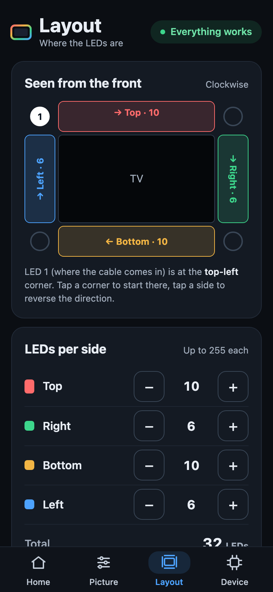
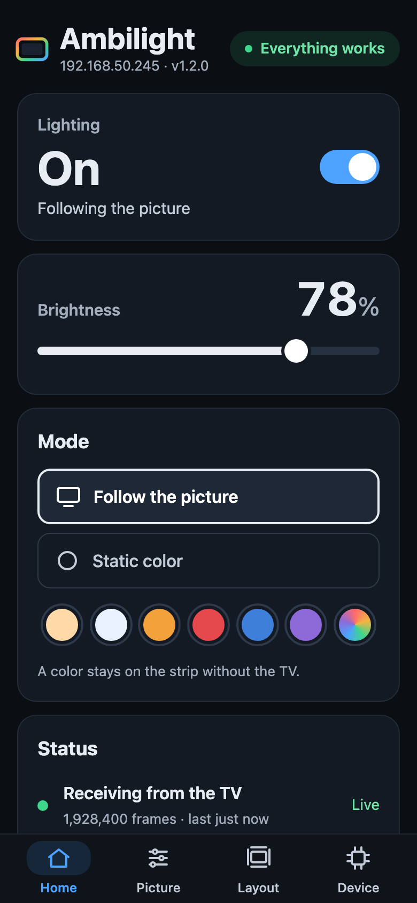

# Installation

End-to-end setup: flash the ESP32, connect it to Wi-Fi, calibrate the strip, install the TV apps.

Build the hardware first — see [HARDWARE.md](HARDWARE.md).

## Prerequisites

| What | Why |
|------|-----|
| [PlatformIO](https://platformio.org/install) (CLI or VS Code extension) | Builds and flashes the ESP32 firmware |
| [Node.js](https://nodejs.org/) 18+ and npm (24 for the TV launcher) | The firmware build compiles the web app (Preact) and embeds it into the binary (`esp32/scripts/embed_web.py` runs `npm run build`); the TV launcher is built from `tv/app` |
| [Tizen Studio](https://developer.samsung.com/smarttv/develop/getting-started/setting-up-sdk/installing-tv-sdk.html) or VS Code with the Tizen extension, plus *TV Extensions* and *Samsung Certificate Extension* | Builds, signs and installs the TV apps |
| A Samsung account | Required to issue the Samsung certificate for your TV |
| TV, ESP32 and PC on the same LAN | Discovery uses UDP broadcast; guest networks and AP/client isolation block it |

---

## 1. ESP32 firmware

### Option A: prebuilt firmware (no toolchain)

Each [release](https://github.com/exzos28/tizen-os-ambilight/releases) has two files:

| File | Flash at | Use |
|------|----------|-----|
| `ambilight-esp32-factory.bin` | `0x0` | First install over USB. **Erases saved settings** (Wi-Fi, calibration) |
| `ambilight-esp32-app.bin` | `0x10000` / OTA | Update of an already flashed device; settings are kept |

First install — with [esptool](https://docs.espressif.com/projects/esptool/) (`pip install esptool`) or the browser-based [ESP Web Flasher](https://espressif.github.io/esptool-js/) (Chrome/Edge, offset `0x0`):

```sh
esptool.py --chip esp32 write_flash 0x0 ambilight-esp32-factory.bin
```

Update over USB, keeping settings:

```sh
esptool.py --chip esp32 write_flash 0x10000 ambilight-esp32-app.bin
```

Then continue with [2. Connect to Wi-Fi](#2-connect-to-wi-fi).

### Option B: build from source

Install the web UI dependencies once:

```sh
cd esp32/web
npm install
```

#### First flash (USB)

Connect the ESP32 over USB, then build and flash:

```sh
cd esp32
pio run -t upload
pio device monitor        # optional: watch the boot log at 115200 baud
```

If PlatformIO picks the wrong serial port, set `upload_port` in `[env:esp32dev]` (e.g. `/dev/cu.usbserial-0001` or `COM3`).

> **Upgrading an older install:** the firmware now uses a partition table with larger app slots (`min_spiffs.csv`). Saved settings are kept, but the new table only takes effect after one USB flash. Until then, OTA updates keep working as long as the firmware fits the old 1.25 MB slot.

#### Later updates (OTA)

Once the ESP32 is on Wi-Fi, update it over the network:

```sh
cd esp32
pio run -e ota -t upload
```

`[env:ota]` in `platformio.ini` uploads to `ambilight.local` (the OTA hostname, resolved via mDNS) with the password `123456`. If you changed the hostname or password in the web app (*Device* tab, *Updates over Wi-Fi*), or mDNS doesn't resolve on your network, update `upload_port` (the device IP works too) and `--auth` there.

## 2. Connect to Wi-Fi

1. With no saved credentials (or if the saved network can't be reached within 12 s), the ESP32 starts an **open** access point `ambilight-setup`.
2. Connect a phone or laptop to it. The captive portal opens automatically; if it doesn't, open `http://192.168.4.1`.
3. The page opens on **Connect the controller to your Wi-Fi**: enter the network name (2.4 GHz: the ESP32 has no 5 GHz radio) and the password, then *Connect*. The ESP32 restarts and joins your network, and the page tells you how to find it again: connect the phone back to your Wi-Fi and open `http://ambilight.local` (the OTA hostname, via mDNS) or the address ending in `.245` (below). The TV finds the controller by itself.

**Finding the device IP.** After connecting, the ESP32 switches to the address `<your subnet>.245` (e.g. `192.168.1.245`) so it stays predictable without a DHCP reservation. If that address doesn't fit the router's network (e.g. it is the router's own address or outside a small subnet), the ESP32 keeps the DHCP address and logs why. It does not check whether another device already uses the address. Change the number on the *Device* tab (*Fixed address, last number*):
- if `.245` is taken on your network, pick another number (1–254), or `0` to keep the address the router assigns (DHCP);
- **with several ESP32 controllers**, give each one its own number (or `0`) — otherwise they all take the same address.

The current IP is also printed in the serial log and in the Telnet log (port 2323).

**After a power outage** the ESP32 may boot faster than the router and fall back to the `ambilight-setup` access point. If Wi-Fi credentials are saved, it keeps the access point up and retries the saved network in the background (every minute, while nobody is connected to the access point). Once the router is back it restarts once and joins it.

## 3. Calibrate the strip

Open `http://<esp32-ip>` (or `http://ambilight.local`) on a phone → *Layout* tab.

<p>
  
  
</p>

1. **LEDs per side.** Under *LEDs per side* set how many LEDs are on the top, right, bottom and left edges (as seen from the front of the TV) with − / + or by typing the number.
2. **Start corner.** In the diagram, tap the corner where the strip's data input is (LED 1, marked white).
3. **Direction.** Tap any side to switch between clockwise and counter-clockwise.

Each change lights a 10-second preview on the strip: **top red, right green, bottom yellow, left blue** (the colors of the sides in the diagram) and LED 1 **white**. If a side shows the wrong color, the corner or direction is wrong. *Light up the strip* shows the preview again. Nothing is stored until you tap **Save layout** (the card says *Not saved* until then); saving also sets the number of LEDs driven to the sum of the sides.

4. **Color correction** (optional, *Picture* tab): gamma (default 2.2), saturation, per-channel white balance. They affect the colors coming from the TV and persist across reboots; *Reset color to defaults* brings them back.
5. **Power limit** (optional, *Picture* tab): set *Limit* to what your PSU can deliver (with some headroom) and *One LED* from your strip's datasheet: watts per meter ÷ LEDs per meter, e.g. 14.4 W/m ÷ 20 = 0.72 W for a 12 V WS2811 strip with 60 LEDs/m. When a frame would exceed the limit, the brightness is lowered for that frame; *Using now* and the Home status show the estimated power. It is an estimate, not a measurement — keep a fuse anyway (see [HARDWARE.md](HARDWARE.md#power)).

The *Home* tab has the everyday controls: the **Lighting** switch (off keeps the strip dark; the settings stay), **Brightness**, and the **Mode**: *Follow the picture* (the strip stays dark until frames arrive from the TV and fades to black 5 s after the last one) or *Static color* (the six colors the TV offers, or any color). Its status shows whether frames arrive from the TV, the estimated strip power and the Wi-Fi signal, and a banner on top says when something is wrong. The *Device* tab has **Blink to identify** (the strip blinks white a few times — handy with several controllers), **Restart**, and the Wi-Fi and OTA settings.

You can test the whole chain without a TV using [`tools/led_tester.py`](../tools/README.md) — `--mode sides` uses the same colors as the preview (without the white first LED):

```sh
python3 tools/led_tester.py --host <esp32-ip> --mode sides
```

## 4. TV apps

The TV side is one **hybrid package** (package ID `fCAYP0k0uD`) with two apps:

| App | Path | Type | Purpose |
|-----|------|------|---------|
| Ambilight | `tv/ui/` (source: `tv/app/`) | Web app | Launcher: lighting on/off, brightness, mode, live preview and status (is this TV supported?) |
| Service | `tv/service/` | .NET service | Captures edge colors and streams them to the ESP32. Declared with `on-boot="true"` |

`tv/ui/tizen_web_project.yaml` lists `../service` as a dependency, so building the launcher also builds the service and packs both into one package.

Two ways to install: with **Apps2Samsung** from a release, without build tools ([4.0](#40-install-with-apps2samsung)), or **from source** with your own certificate (4.1–4.3).

### 4.0 Install with Apps2Samsung

Every release has the package attached as `ambilight-tv-vX.Y.Z.wgt`. It is signed with the Tizen SDK's default certificate — a TV only accepts a certificate bound to its own DUID — so it has to be re-signed for your TV. [Apps2Samsung](https://github.com/Apps2Samsung/Apps2Samsung) does that.

1. Turn on Developer Mode with your PC's IP as *Host PC IP* ([4.1](#41-enable-developer-mode-on-the-tv), steps 1–3).
2. Download `ambilight-tv-vX.Y.Z.wgt` from the [latest release](https://github.com/exzos28/tizen-os-ambilight/releases/latest) and install it in Apps2Samsung as a custom `.wgt`. On the first install it creates a certificate for your TV (Samsung account sign-in in the browser).
3. If the app is already installed from VS Code, delete it on the TV first: a package signed with another certificate can't be installed over it.
4. Continue with [4.4 Start](#44-start).

**TV-Store already on the TV?** Apps2Samsung's TV-Store app installs a file without a PC connection, so *Host PC IP* can stay as it is (e.g. `127.0.0.1` on a rooted TV): open `http://<tv-ip>:8077/upload` on a phone or PC in the same network, send `ambilight-tv-vX.Y.Z.wgt`, then press **Install on this TV** in TV-Store. Tested on a QN92D (2024): capture, the launcher and streaming to the ESP32 work.

Apps2Samsung may pick a Partner certificate because the service starts on boot (`on-boot="true"`). The package is not in the Apps2Samsung catalog yet; the entry is prepared in [packaging/apps2samsung](../packaging/apps2samsung/).

### 4.1 Enable Developer Mode on the TV

1. Open **Apps**, then press **1 2 3 4 5** on the remote (on newer models: Apps → App Settings → 1 2 3 4 5).
2. Turn **Developer mode** on and enter your PC's IP address as **Host PC IP**.
3. Restart the TV fully: hold the power button on the remote for ~5 seconds until the logo appears.
4. The Apps panel now shows **DEVELOP MODE**.

### 4.2 Connect and create a certificate

1. Connect to the TV: *Device Manager* → *Remote Device Manager* → add the TV's IP (or `sdb connect <tv-ip>`).
2. Open *Certificate Manager* → **+** → **Samsung** (not Tizen) → *TV*.
3. Create a new author certificate and sign in with your Samsung account when asked.
4. Create the distributor certificate with privilege level **Public**. With the TV connected, its DUID is added automatically (or read it with `sdb shell 0 getduid`).

A regular Samsung account and a **Public** distributor certificate are enough. The service requests `http://developer.samsung.com/privilege/contentanalysis`, which Samsung lists as a partner privilege, but a Public certificate bound to your TV's DUID installs and runs it in Developer Mode.

### 4.3 Build and install

**Outputs.** By default the service streams to ESP32 controllers only. To also (or instead) stream to a HyperHDR server, edit `tv/service/res/ambilight.json` before building — see [HYPERHDR.md](HYPERHDR.md) (untested on a TV).

The projects use the VS Code Tizen extension format (`tizen_web_project.yaml`, `tizen_dotnet_project.yaml`).

1. Build the launcher: `cd tv/app && npm ci && npm run build` — again after every change in `tv/app` or after updating the repository. It writes `index.html` and `assets/` into `tv/ui`, next to `config.xml`; without this step `tv/ui` has no `index.html` and the app won't start.
2. Open the `tv/` folder in VS Code with the Tizen extension and select your Samsung certificate profile as the active signing profile.
3. Build the **`tv/ui`** project — this produces the hybrid package with both apps — and run it on the connected TV.

Don't install a launcher-only `.wgt` (e.g. built with `tizen build-web` + `tizen package -t wgt`): it has the same package ID, so it replaces the hybrid package and removes the service.

If you change the package ID, update it in both manifests and in `tvApp` in `protocol/constants.json` (then `npm run protocol:gen` at the repo root), which the launcher reads.

To work on the launcher without a TV, run `npm run dev` in `tv/app` and open the printed URL: outside the TV it runs against a built-in mock (`?state=ok|lost|none|off|unsupported`).

### 4.4 Start

The service starts on its own when the TV boots. After the first install, open **Ambilight** on the TV and press **Start** in the banner. The service waits 2 s, broadcasts a discovery probe and starts streaming to every ESP32 that answers. The strip should follow the picture within a few seconds.

Home in **Ambilight** shows whether everything works, turns the lighting on and off, sets the brightness and switches between following the picture and a static color — on every controller at once. If something is wrong, a banner on top says what and offers the fix when there is one (*Start*, *Search now*). *Test pattern* shows a rotating color wheel the strip should follow. Back exits the app.

The service keeps looking for controllers in the background (new ones and IP changes are picked up within ~30 s); *Search now* probes immediately.

---

## Factory reset

Hold the **BOOT** button (GPIO 0) on the ESP32 for 3 seconds. All settings, including Wi-Fi credentials, are erased and the device restarts into `ambilight-setup` AP mode.

## Logs

| Source | How to read |
|--------|-------------|
| ESP32 | Serial at 115200 baud, or Telnet: `nc <esp32-ip> 2323` |
| TV service | Run `python3 tools/server.py` on your PC. It answers discovery like an ESP32, so the TV also sends its event log (HTTP, port 9000) and frames to the PC — see [tools](../tools/README.md) |

## Troubleshooting

**The strip stays dark.**
- Check the mode on the web app's *Home* tab: in *Follow the picture* the strip is dark until frames arrive and fades out 5 s after they stop. Pick a *Static color* to test the wiring.
- Check that the ESP32 GND and the strip GND are connected, and that DATA goes to GPIO 23 through the 330 Ω resistor.

**Colors are wrong (e.g. red shows as blue).** WS2811 strips differ in channel order. The firmware assumes **BRG** — see `FastLED.addLeds<WS2811, LED_PIN, BRG>` in `esp32/src/LEDController.cpp`. Light the strip red with `led_tester.py --mode solid --color 255 0 0`, find the order that gives red (`RGB`, `GRB`, `BRG`…), change it and reflash.

**Sides are mirrored or shifted.** Re-check the start corner and direction in the calibration preview: the white LED must be the physical first LED.

**The TV doesn't find the ESP32.**
- TV and ESP32 must be in the same subnet, with broadcast allowed (no guest network, no client isolation).
- The service keeps probing: every 2 s for the first minute, then every 10 s (every 30 s once something answered). Once the ESP32 is reachable it is picked up automatically; press *Search now* in the launcher to retry immediately.
- In the ESP32 Telnet log, look for `[Discovery] Replied to …`.

**The strip doesn't react to the picture on some models.** The hardware color-measurement block is missing on some processors (e.g. Q6F, [#2](https://github.com/exzos28/tizen-os-ambilight/issues/2)). The TV service log shows `CaptureError invalid HW condition`. Please report your model — see [CONTRIBUTING.md](CONTRIBUTING.md).
