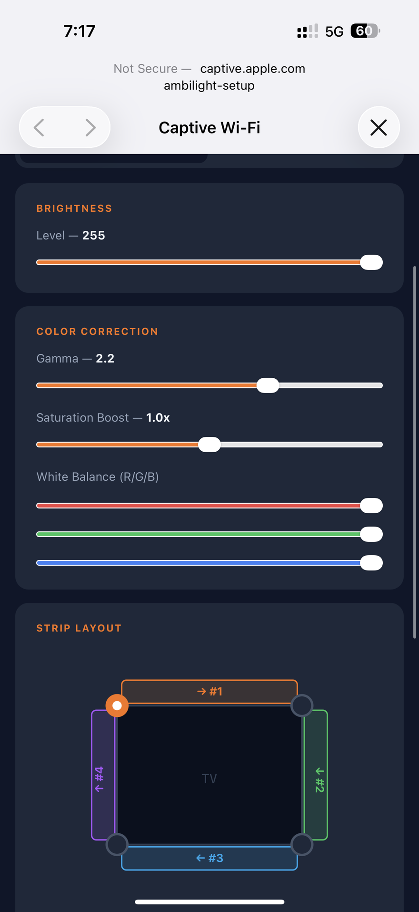

# Installation

End-to-end setup: flash the ESP32, connect it to Wi-Fi, calibrate the strip, install the TV apps.

Build the hardware first — see [HARDWARE.md](HARDWARE.md).

## Prerequisites

| What | Why |
|------|-----|
| [PlatformIO](https://platformio.org/install) (CLI or VS Code extension) | Builds and flashes the ESP32 firmware |
| [Node.js](https://nodejs.org/) 18+ and npm | The firmware build compiles the React web UI and embeds it into the binary (`esp32/scripts/embed_web.py` runs `npm run build`) |
| [Tizen Studio](https://developer.samsung.com/smarttv/develop/getting-started/setting-up-sdk/installing-tv-sdk.html) or VS Code with the Tizen extension, plus *TV Extensions* and *Samsung Certificate Extension* | Builds, signs and installs the TV apps |
| A Samsung account | Required to issue the Samsung certificate for your TV |
| TV, ESP32 and PC on the same LAN | Discovery uses UDP broadcast; guest networks and AP/client isolation block it |

---

## 1. ESP32 firmware

### Option A: prebuilt firmware (no toolchain)

Each [release](https://github.com/exzos28/tizen-os-ambilight/releases) has two files:

| File | Flash at | Use |
|------|----------|-----|
| `ambilight-esp32-factory.bin` | `0x0` | First install over USB. **Erases saved settings** (Wi-Fi, calibration) |
| `ambilight-esp32-app.bin` | `0x10000` / OTA | Update of an already flashed device; settings are kept |

First install — with [esptool](https://docs.espressif.com/projects/esptool/) (`pip install esptool`) or the browser-based [ESP Web Flasher](https://espressif.github.io/esptool-js/) (Chrome/Edge, offset `0x0`):

```sh
esptool.py --chip esp32 write_flash 0x0 ambilight-esp32-factory.bin
```

Update over USB, keeping settings:

```sh
esptool.py --chip esp32 write_flash 0x10000 ambilight-esp32-app.bin
```

Then continue with [2. Connect to Wi-Fi](#2-connect-to-wi-fi).

### Option B: build from source

Install the web UI dependencies once:

```sh
cd esp32/web
npm install
```

#### First flash (USB)

Connect the ESP32 over USB, then build and flash:

```sh
cd esp32
pio run -t upload
pio device monitor        # optional: watch the boot log at 115200 baud
```

If PlatformIO picks the wrong serial port, set `upload_port` in `[env:esp32dev]` (e.g. `/dev/cu.usbserial-0001` or `COM3`).

> **Upgrading an older install:** the firmware now uses a partition table with larger app slots (`min_spiffs.csv`). Saved settings are kept, but the new table only takes effect after one USB flash. Until then, OTA updates keep working as long as the firmware fits the old 1.25 MB slot.

#### Later updates (OTA)

Once the ESP32 is on Wi-Fi, update it over the network:

```sh
cd esp32
pio run -e ota -t upload
```

`[env:ota]` in `platformio.ini` uploads to `ambilight.local` (the OTA hostname, resolved via mDNS) with the password `123456`. If you changed the hostname or password in the web UI (*WiFi* tab), or mDNS doesn't resolve on your network, update `upload_port` (the device IP works too) and `--auth` there.

## 2. Connect to Wi-Fi

1. With no saved credentials (or if the saved network can't be reached within 12 s), the ESP32 starts an **open** access point `ambilight-setup`.
2. Connect a phone or laptop to it. The captive portal opens automatically; if it doesn't, open `http://192.168.4.1`.
3. On the *WiFi* tab enter your network's SSID and password and save. The ESP32 restarts and joins your network.

**Finding the device IP.** After connecting, the ESP32 switches to the address `<your subnet>.245` (e.g. `192.168.1.245`) so it stays predictable without a DHCP reservation. This address is set statically, without checking whether another device already uses it:
- if `.245` is taken on your network, change `PREFERRED_IP_LAST_OCTET` in `esp32/src/NetworkManager.h`, or set it to `0` to keep the DHCP address;
- **with several ESP32 controllers**, give each one a different value (or `0`) before flashing — otherwise they all take the same address.

The current IP is also printed in the serial log and in the Telnet log (port 2323).

**After a power outage** the ESP32 may boot faster than the router and fall back to the `ambilight-setup` access point. If Wi-Fi credentials are saved, it keeps the access point up and retries the saved network in the background (every minute, while nobody is connected to the access point). Once the router is back it restarts once and joins it.

## 3. Calibrate the strip

Open `http://<esp32-ip>` → *LEDs* tab.

<p>
  
  
</p>

The tab has two modes, switched at the top: **Dynamic** (follows the TV) and **Plain** (a fixed color). The strip layout editor and color correction are shown only in **Dynamic** mode — switch to it first.

1. **LED count per side.** Click each count and enter how many LEDs are on the top, right, bottom and left edges (as seen from the front of the TV).
2. **Start corner.** Click the corner where the strip's data input is.
3. **Direction.** Click a side to toggle clockwise / counter-clockwise.

Each change lights a 10-second preview on the strip: **top red, right green, bottom yellow, left blue**, and the first LED **white**. If a side shows the wrong color, the corner or direction is wrong.

4. **Color correction** (optional): gamma (default 2.2), saturation boost, per-channel white balance. They affect the colors coming from the TV and persist across reboots.

In **Plain** mode the tab shows the LED count, brightness and the color picker; the strip shows that color. In **Dynamic** mode the strip stays dark until frames arrive and fades to black 5 s after the last one.

You can test the whole chain without a TV using [`tools/led_tester.py`](../tools/README.md) — `--mode sides` uses the same colors as the preview (without the white first LED):

```sh
python3 tools/led_tester.py --host <esp32-ip> --mode sides
```

## 4. TV apps

The TV side is one **hybrid package** (package ID `fCAYP0k0uD`) with two apps:

| App | Path | Type | Purpose |
|-----|------|------|---------|
| Ambilight | `tv/ui/` | Web app | Launcher with *Start* / *Stop* buttons |
| Service | `tv/service/` | .NET service | Captures edge colors and streams them to the ESP32. Declared with `on-boot="true"` |

`tv/ui/tizen_web_project.yaml` lists `../service` as a dependency, so building the launcher also builds the service and packs both into one package.

### 4.1 Enable Developer Mode on the TV

1. Open **Apps**, then press **1 2 3 4 5** on the remote (on newer models: Apps → App Settings → 1 2 3 4 5).
2. Turn **Developer mode** on and enter your PC's IP address as **Host PC IP**.
3. Restart the TV fully: hold the power button on the remote for ~5 seconds until the logo appears.
4. The Apps panel now shows **DEVELOP MODE**.

### 4.2 Connect and create a certificate

1. Connect to the TV: *Device Manager* → *Remote Device Manager* → add the TV's IP (or `sdb connect <tv-ip>`).
2. Open *Certificate Manager* → **+** → **Samsung** (not Tizen) → *TV*.
3. Create a new author certificate and sign in with your Samsung account when asked.
4. Create the distributor certificate with privilege level **Public**. With the TV connected, its DUID is added automatically (or read it with `sdb shell 0 getduid`).

A regular Samsung account and a **Public** distributor certificate are enough. The service requests `http://developer.samsung.com/privilege/contentanalysis`, which Samsung lists as a partner privilege, but a Public certificate bound to your TV's DUID installs and runs it in Developer Mode.

### 4.3 Build and install

**Outputs.** By default the service streams to ESP32 controllers only. To also (or instead) stream to a HyperHDR server, edit `tv/service/res/ambilight.json` before building — see [HYPERHDR.md](HYPERHDR.md) (untested on a TV).

The projects use the VS Code Tizen extension format (`tizen_web_project.yaml`, `tizen_dotnet_project.yaml`).

1. Open the `tv/` folder in VS Code with the Tizen extension and select your Samsung certificate profile as the active signing profile.
2. Build the **`tv/ui`** project — this produces the hybrid package with both apps — and run it on the connected TV.

Don't install a launcher-only `.wgt` (e.g. built with `tizen build-web` + `tizen package -t wgt`): it has the same package ID, so it replaces the hybrid package and removes the service.

If you change the package ID, update it in both manifests and `SERVICE_APP_ID` in `tv/ui/main.js`.

### 4.4 Start

Open **Ambilight** on the TV and press **Start**. The service waits 2 s, broadcasts a discovery probe and starts streaming to every ESP32 that answers. The strip should follow the picture within a few seconds.

The service also starts on its own when the TV boots. It keeps looking for controllers in the background (new ones and IP changes are picked up within ~30 s); pressing **Start** while it is running probes immediately, reconnects HyperHDR and restarts capture.

---

## Factory reset

Hold the **BOOT** button (GPIO 0) on the ESP32 for 3 seconds. All settings, including Wi-Fi credentials, are erased and the device restarts into `ambilight-setup` AP mode.

## Logs

| Source | How to read |
|--------|-------------|
| ESP32 | Serial at 115200 baud, or Telnet: `nc <esp32-ip> 2323` |
| TV service | Run `python3 tools/server.py` on your PC. It answers discovery like an ESP32, so the TV also sends its event log (HTTP, port 9000) and frames to the PC — see [tools](../tools/README.md) |

## Troubleshooting

**The strip stays dark.**
- Check the mode: in *Dynamic* the strip is dark until frames arrive and fades out 5 s after they stop. Switch to *Plain* to test the wiring.
- Check that the ESP32 GND and the strip GND are connected, and that DATA goes to GPIO 23 through the 330 Ω resistor.

**Colors are wrong (e.g. red shows as blue).** WS2811 strips differ in channel order. The firmware assumes **BRG** — see `FastLED.addLeds<WS2811, LED_PIN, BRG>` in `esp32/src/LEDController.cpp`. Light the strip red with `led_tester.py --mode solid --color 255 0 0`, find the order that gives red (`RGB`, `GRB`, `BRG`…), change it and reflash.

**Sides are mirrored or shifted.** Re-check the start corner and direction in the calibration preview: the white LED must be the physical first LED.

**The TV doesn't find the ESP32.**
- TV and ESP32 must be in the same subnet, with broadcast allowed (no guest network, no client isolation).
- The service keeps probing: every 2 s for the first minute, then every 10 s (every 30 s once something answered). Once the ESP32 is reachable it is picked up automatically; press *Start* to retry immediately.
- In the ESP32 Telnet log, look for `[Discovery] Replied to …`.

**The strip doesn't react to the picture on some models.** The hardware color-measurement block is missing on some processors (e.g. Q6F, [#2](https://github.com/exzos28/tizen-os-ambilight/issues/2)). The TV service log shows `CaptureError invalid HW condition`. Please report your model — see [CONTRIBUTING.md](CONTRIBUTING.md).
