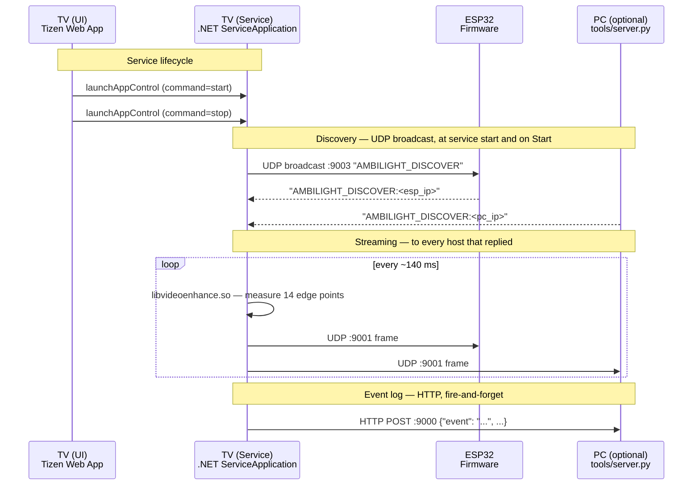

# Networking

Single reference for every port, packet format and endpoint used by the project.



## Ports

| Port | Protocol | Listener | Sender | Purpose |
|------|----------|----------|--------|---------|
| 80 | HTTP | ESP32 | Browser | Web UI and [HTTP API](#esp32-http-api) |
| 2323 | TCP (Telnet) | ESP32 | You | Remote log (`nc <esp32-ip> 2323`) |
| 3232 | UDP | ESP32 | PlatformIO (`espota`) | Arduino OTA invitation; the firmware itself is then pulled over TCP from the PC |
| 9000 | HTTP | `tools/server.py` | TV service | Event log (JSON POST). The ESP32 does not listen here |
| 9001 | UDP | ESP32, `tools/server.py` | TV service, `tools/led_tester.py` | [Color frames](#color-frame-udp-9001) |
| 9003 | UDP | ESP32, `tools/server.py` | TV service (broadcast) | [Discovery](#discovery-udp-9003) |
| 53 | UDP (DNS) | ESP32, AP mode only | Clients of `ambilight-setup` | Captive portal: every name resolves to `192.168.4.1` |
| 19400 | TCP | HyperHDR | TV service (optional) | [HyperHDR FlatBuffers input](#hyperhdr-tcp-19400) — off by default |

## Discovery (UDP 9003)

1. The TV service broadcasts the ASCII string `AMBILIGHT_DISCOVER` to `255.255.255.255:9003`.
2. Every listener replies by unicast to the sender's address and port: `AMBILIGHT_DISCOVER:<own-ip>`.
3. The service collects replies for 2 s. If at least one arrived, it streams to **all** of them. Otherwise it retries — 30 quick attempts (~1 min), then one every 10 s — until a host answers.

Discovery runs in the background and never delays capture. Once hosts are known, the service re-probes every 30 s, so new controllers and IP changes are picked up while streaming; a host that hasn't replied for 2 minutes is dropped. Pressing *Start* in the TV launcher probes immediately.

## Color frame (UDP 9001)

One datagram per frame, no header or checksum:

```
offset  size          field
0       1             hCount — samples per horizontal edge (top, bottom)
1       1             vCount — samples per vertical edge (left, right)
2       hCount × 3    top     R,G,B …   left → right
        vCount × 3    right   R,G,B …   top → bottom
        hCount × 3    bottom  R,G,B …   right → left
        vCount × 3    left    R,G,B …   bottom → top
```

The samples go clockwise around the screen starting at the top-left corner. Channels are 8-bit (the hardware returns 10-bit values; the service shifts them right by 2).

With the current TV settings (`hCount = 4`, `vCount = 3`) a frame is `2 + 14 × 3 = 44` bytes.

ESP32 acceptance rules (`esp32/src/UDPReceiver.cpp`):
- `hCount` and `vCount` must be ≤ 32, and the datagram must be at least `2 + (hCount + vCount) × 6` bytes and at most 512 bytes.
- If several frames are queued, only the newest one is applied.
- Frames are applied only in *Dynamic* mode (`led_mode = 1`) and not during a calibration preview.
- The ESP32 interpolates each edge to the LED count configured for that side, so `hCount`/`vCount` do not need to match the strip.

## HyperHDR (TCP 19400)

Optional output, configured in `tv/service/res/ambilight.json` — setup in [HYPERHDR.md](HYPERHDR.md). The service speaks HyperHDR's FlatBuffers protocol (`hyperhdr_request.fbs`, v20+):

1. Each message is a FlatBuffers `Request`, prefixed with its length as a 4-byte **big-endian** integer.
2. After connecting: `Register { origin: "Tizen Ambilight", priority }` (50–250).
3. Per frame: `Image { RawImage { data, width, height } }` — an RGB image (default 64 × 36) rendered from the edge samples, `duration` left at −1.
4. HyperHDR answers every message with a `Reply { error, video, registered }`; the service reads them and treats 3 s without an answer as a dead connection.
5. Disconnecting releases the priority; no `Clear` is sent.

## TV service event log (HTTP 9000)

`POST http://<host>:9000/` with a JSON body:

```json
{"event": "Frame", "app": "Service", "timestamp": "2026-10-31T12:00:00.0000000Z", "data": "#201 7fps p0=(12,8,40)"}
```

The service sends events to every discovered host. Only `tools/server.py` listens on this port; requests to ESP32s fail silently.

## ESP32 HTTP API

All `POST` endpoints take `application/x-www-form-urlencoded` bodies and return `{"message": "..."}`. Omitted or non-numeric fields keep their current value; out-of-range values are clamped. Changes persist in NVS.

| Method | Path | Fields | Effect |
|--------|------|--------|--------|
| GET | `/` | — | Web UI (single HTML file, served gzipped from flash) |
| GET | `/status` | — | `ip`, `mode` (`STA`/`AP`), `ssid`, `rssi`, `connected`, `gateway` |
| GET | `/config` | — | Every setting from the table in [ARCHITECTURE.md](ARCHITECTURE.md#esp32-settings-nvs) (passwords excluded) plus `max_leds` |
| GET | `/metrics` | — | `heap_free`, `heap_total`, `heap_min`, `uptime_s`, `cpu_mhz`, `power_w` (estimated LED power of the last frame), `power_limited` |
| POST | `/save/leds` | `num_leds` (1–1500), `brightness` (0–255), `color` (`#rrggbb`), `gamma` (0.5–3), `saturation` (0–2), `wb_r`, `wb_g`, `wb_b` (0–255), `power_limit_w` (0–2000, 0 = off), `pixel_watts` (0.05–5) | Saved. `brightness` applies immediately; `num_leds` and `color` are shown right away only in plain mode; gamma, saturation and white balance apply to the next TV frame |
| POST | `/save/calibration` | `led_top`, `led_right`, `led_bottom`, `led_left` (0–255), `start_corner` (0–3), `clockwise` (0/1) | Saves the layout, sets `num_leds` to the sum of the sides, shows the 10 s preview (then the strip returns to the current mode) |
| POST | `/preview/calibration` | Same as above | Shows the preview without saving |
| POST | `/save/mode` | `led_mode` (0 = plain, 1 = dynamic) | Switches mode |
| POST | `/save/network` | `wifi_ssid`, `wifi_pass`, `ota_host`, `ota_pass` (empty passwords keep the current ones), `ip_octet` (0 = DHCP, 2–254; anything else → HTTP 400, nothing saved) | Saves and **restarts** the ESP32 |

The API has no authentication — anyone on the LAN can change settings, including Wi-Fi credentials.

Captive-portal probe URLs (`/generate_204`, `/hotspot-detect.html`, `/connecttest.txt`, …) and any unknown path redirect to `/`.

Example:

```sh
curl -X POST http://192.168.1.245/save/mode -d led_mode=0                    # plain mode
curl -X POST http://192.168.1.245/save/leds -d brightness=128 -d color=%23ff8800
```
