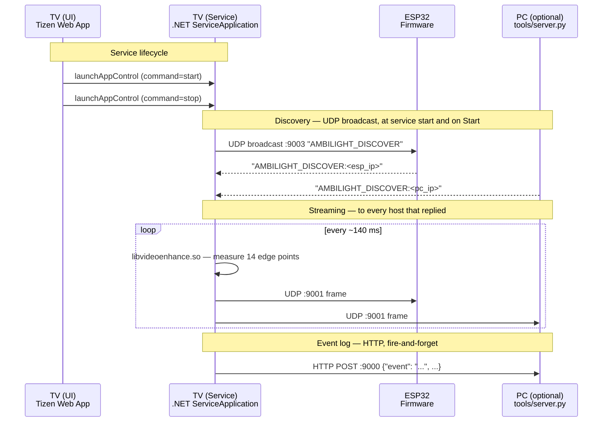

# Networking

Single reference for every port, packet format and endpoint used by the project.

The machine-readable definition lives in [`protocol/`](../protocol/README.md): JSON Schemas for
every HTTP body and MessagePort message (with ranges, defaults and units), `constants.json` for
ports, discovery and frame layout, and example messages. TypeScript types and clients
(`packages/protocol`) and the firmware's `esp32/src/generated/ProtocolLimits.h` are generated
from it. The tables below are the human-readable summary; if they disagree, `protocol/` wins.



## Ports

| Port | Protocol | Listener | Sender | Purpose |
|------|----------|----------|--------|---------|
| 80 | HTTP | ESP32 | Browser | Web UI and [HTTP API](#esp32-http-api) |
| 2323 | TCP (Telnet) | ESP32 | You | Remote log (`nc <esp32-ip> 2323`) |
| 3232 | UDP | ESP32 | PlatformIO (`espota`) | Arduino OTA invitation; the firmware itself is then pulled over TCP from the PC |
| 9000 | HTTP | `tools/server.py` | TV service | Event log (JSON POST). The ESP32 does not listen here |
| 9001 | UDP | ESP32, `tools/server.py` | TV service, `tools/led_tester.py` | [Color frames](#color-frame-udp-9001) |
| 9003 | UDP | ESP32, `tools/server.py` | TV service (broadcast) | [Discovery](#discovery-udp-9003) |
| 53 | UDP (DNS) | ESP32, AP mode only | Clients of `ambilight-setup` | Captive portal: every name resolves to `192.168.4.1` |
| 19400 | TCP | HyperHDR | TV service (optional) | [HyperHDR FlatBuffers input](#hyperhdr-tcp-19400) — off by default |

## Discovery (UDP 9003)

1. The TV service broadcasts the ASCII string `AMBILIGHT_DISCOVER` to `255.255.255.255:9003`.
2. Every listener replies by unicast to the sender's address and port: `AMBILIGHT_DISCOVER:<own-ip>`.
3. The service collects replies for 2 s. If at least one arrived, it streams to **all** of them. Otherwise it retries — 30 quick attempts (~1 min), then one every 10 s — until a host answers.

Discovery runs in the background and never delays capture. Once hosts are known, the service re-probes every 30 s, so new controllers and IP changes are picked up while streaming; a host that hasn't replied for 2 minutes is dropped. *Search now* in the TV launcher (shown while no controller answers) probes immediately.

## Color frame (UDP 9001)

One datagram per frame, no header or checksum:

```
offset  size          field
0       1             hCount — samples per horizontal edge (top, bottom)
1       1             vCount — samples per vertical edge (left, right)
2       hCount × 3    top     R,G,B …   left → right
        vCount × 3    right   R,G,B …   top → bottom
        hCount × 3    bottom  R,G,B …   right → left
        vCount × 3    left    R,G,B …   bottom → top
```

The samples go clockwise around the screen starting at the top-left corner. Channels are 8-bit (the hardware returns 10-bit values; the service shifts them right by 2).

With the current TV settings (`hCount = 4`, `vCount = 3`) a frame is `2 + 14 × 3 = 44` bytes.

ESP32 acceptance rules (`esp32/src/UDPReceiver.cpp`):
- `hCount` and `vCount` must be ≤ 32, and the datagram must be at least `2 + (hCount + vCount) × 6` bytes and at most 512 bytes.
- If several frames are queued, only the newest one is applied.
- Frames are applied only with the lighting on (`power = true`), in *Dynamic* mode (`led_mode = 1`) and not during a calibration preview. An identify blink does not block them: the strip blends back to the latest frame when it ends.
- `frames_rx` in [`GET /metrics`](#esp32-http-api) counts every datagram that passes the checks above, including frames superseded by a newer queued one and frames ignored because of the power flag, the mode or a preview. Malformed datagrams and datagrams the network stack dropped before the socket are not counted. `last_frame_ms` is the time since the last such frame.
- The ESP32 interpolates each edge to the LED count configured for that side, so `hCount`/`vCount` do not need to match the strip.

## HyperHDR (TCP 19400)

Optional output, configured in `tv/service/res/ambilight.json` — setup in [HYPERHDR.md](HYPERHDR.md). The service speaks HyperHDR's FlatBuffers protocol (`hyperhdr_request.fbs`, v20+):

1. Each message is a FlatBuffers `Request`, prefixed with its length as a 4-byte **big-endian** integer.
2. After connecting: `Register { origin: "Tizen Ambilight", priority }` (50–250).
3. Per frame: `Image { RawImage { data, width, height } }` — an RGB image (default 64 × 36) rendered from the edge samples, `duration` left at −1.
4. HyperHDR answers every message with a `Reply { error, video, registered }`; the service reads them and treats 3 s without an answer as a dead connection.
5. Disconnecting releases the priority; no `Clear` is sent.

## TV service event log (HTTP 9000)

`POST http://<host>:9000/` with a JSON body:

```json
{"event": "Frame", "app": "Service", "timestamp": "2026-10-31T12:00:00.0000000Z", "data": "#201 7fps p0=(12,8,40)"}
```

The service sends events to every discovered host. Only `tools/server.py` listens on this port; requests to ESP32s fail silently.

## ESP32 HTTP API

Schemas: [`protocol/schemas/esp32/`](../protocol/schemas/esp32/). All `POST` endpoints take `application/x-www-form-urlencoded` bodies and return `{"message": "..."}`. Omitted or non-numeric fields keep their current value; out-of-range values are clamped. The exceptions are `led_mode`, `power` and `ip_octet`: an invalid value is rejected with HTTP 400 and `{"message": "<reason>"}`, and nothing from that request is saved. Changes persist in NVS unless noted otherwise.

| Method | Path | Fields | Effect |
|--------|------|--------|--------|
| GET | `/` | — | Web UI (single HTML file, served gzipped from flash) |
| GET | `/status` | — | `version` (firmware), `ip`, `mode` (`STA`/`AP`), `ssid`, `rssi`, `connected`, `gateway` |
| GET | `/config` | — | Every setting from the table in [ARCHITECTURE.md](ARCHITECTURE.md#esp32-settings-nvs) (passwords excluded) plus `max_leds`. Includes `power` (`true`/`false`) |
| GET | `/metrics` | — | `heap_free`, `heap_total`, `heap_min`, `uptime_s`, `cpu_mhz`, `power_w` (estimated LED power of the last frame), `power_limited`, `frames_rx` (valid UDP frames received since boot, see [Color frame](#color-frame-udp-9001)), `last_frame_ms` (ms since the last valid frame, `-1` if none yet), `config_rev` (settings revision, see below) |
| POST | `/save/leds` | `num_leds` (1–1500), `brightness` (0–255), `color` (`#rrggbb`), `gamma` (0.5–3), `saturation` (0–2), `wb_r`, `wb_g`, `wb_b` (0–255), `power_limit_w` (0–2000, 0 = off), `pixel_watts` (0.05–5) | Saved. `brightness`, `power_limit_w` and `pixel_watts` apply immediately (the strip is redrawn in both modes); `num_leds` and `color` are shown right away only in plain mode; gamma, saturation and white balance apply to the next TV frame |
| POST | `/save/calibration` | `led_top`, `led_right`, `led_bottom`, `led_left` (0–255), `start_corner` (0–3), `clockwise` (0/1) | Saves the layout, sets `num_leds` to the sum of the sides, shows the 10 s preview (then the strip returns to the current mode) |
| POST | `/preview/calibration` | Same as above | Shows the preview without saving |
| POST | `/save/mode` | `led_mode` (required: exactly `0` = plain or `1` = dynamic; missing or anything else → HTTP 400 `{"message": "led_mode must be 0 or 1"}` and nothing is saved) | Switches mode |
| POST | `/save/power` | `power` (required: exactly `0` = off or `1` = on; missing or anything else → HTTP 400 `{"message": "power must be 0 or 1"}` and nothing is saved) | Lighting on/off. Off: the strip is dark in both modes and UDP frames are ignored; brightness, color and mode are kept. The calibration preview and `/identify` still light the strip, then it returns to dark |
| POST | `/identify` | — | Blinks the whole strip white 3 times over 2 s (including LEDs a longer calibration preview left lit), then restores the previous output. Settings changed meanwhile are applied but shown only when the blink ends. Not saved |
| POST | `/restart` | — | Replies, then restarts the ESP32 about 0.5 s later |
| POST | `/save/network` | `wifi_ssid`, `wifi_pass`, `ota_host`, `ota_pass` (empty passwords keep the current ones), `ip_octet` (0 = DHCP, 1–254; anything else → HTTP 400 and nothing is saved) | Saves and **restarts** the ESP32 |

**Settings revision:** `config_rev` in `GET /metrics` (uint32) lets clients notice changes made by another client (e.g. the TV launcher and the web UI on a phone) from the metrics they already poll. It starts at a random value at boot and goes up by one after every successful `POST /save/leds`, `/save/mode`, `/save/power`, `/save/calibration` and `/save/network` (just before the restart), even if the values didn't change. `/preview/calibration`, `/identify`, `/restart` and rejected requests (HTTP 400) don't change it. Compare it for equality only: when it differs from the value seen last, re-read `GET /config`. The random start means a value cached before a reboot almost never matches by accident.

The API has no authentication — anyone on the LAN can change settings, including Wi-Fi credentials.

**CORS:** every response (including errors, redirects and the web UI) carries `Access-Control-Allow-Origin: *`, and an `OPTIONS` request on any path returns `204` with `Access-Control-Allow-Methods: GET, POST, OPTIONS` and `Access-Control-Allow-Headers: Content-Type`. This lets other web apps (e.g. the TV launcher) call the API — and it also means any web page open in a browser on the LAN can read and change the settings.

Captive-portal probe URLs (`/generate_204`, `/hotspot-detect.html`, `/connecttest.txt`, …) and any unknown path redirect to `/` (except `OPTIONS` requests, which get the `204` above).

Example:

```sh
curl -X POST http://192.168.1.245/save/mode -d led_mode=0                    # plain mode
curl -X POST http://192.168.1.245/save/leds -d brightness=128 -d color=%23ff8800
curl -X POST http://192.168.1.245/save/power -d power=0                     # lighting off
curl -X POST http://192.168.1.245/identify                                  # which strip is this?
```
